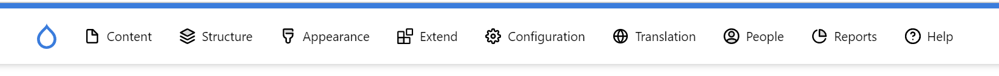

# VuePal

VuePal provides a bridge between Drupal and Vue. It comes with a set of
components and composables to make your life easier when working with Drupal.

## Frontend Routing

```ts [nuxt.config.ts]
export default defineNuxtConfig({
  vuepal: {
    frontendRouting: {
      enabled: true,
      langcodes: ['de', 'fr', 'en'],
      outputPath: './../drupal/config/default/frontend_routing.settings.yml',
    },
  },
})
```

With this feature enabled, you can create a static frontend page in Nuxt and
still use all the routing features of Drupal in your frontend application. You
can define your aliases in the frontend page using `definePageMeta`. The module
will automatically create a Drupal configuration file that can be imported and
processed by the
[Drupal frontend_routing](https://www.drupal.org/project/frontend_routing)
module.

```ts [pages/static-page/example.vue]
definePageMeta({
  name: 'static-page-example',
  drupalFrontendRoute: true,
  languageMapping: {
    de: '/de/statisch',
    fr: '/fr/statique',
    en: '/en/static',
  },
})
```

## Drupal Route

```ts [nuxt.config.ts]
export default defineNuxtConfig({
  vuepal: {
    drupalRoute: {
      enabled: true,
    },
  },
})
```

This option enables the `useDrupalRoute()` composable. This composable provides
the necessary GraphQL fragment and query to fetch the route data and metatags of
a Drupal page.

### useDrupalRouteQuery()

You can optionally also let Vuepal generate GraphQL route queries for you:

```ts
export default defineNuxtConfig({
  vuepal: {
    drupalRoute: {
      enabled: true,
      // The route queries that will be generated for useDrupalRouteQuery().
      routeQueries: {
        slug: { fragments: ['nodePage'] },
        nodePage: { fragments: ['nodePage'] },
        nodeCanonical: {
          fragments: ['nodeContact', 'nodePage', 'nodePressRelease'],
        },
      },
    },
  },
})
```

This will generate three route queries. They can be used with
`useDrupalRouteQuery`:

```ts
const { entity } = await useDrupalRouteQuery('slug')
```

Behind the scenes, this will call `useGraphqlQuery` and `useDrupalRoute`.

#### Redirects

If Drupal returns a redirect for the path, the composable redirects to the
target and returns without throwing a 404, also when `noError` is not set. In
this case `entity` is `undefined`, so the page must not assume that it is set.

On the server the redirect is sent as an HTTP redirect. On the client the
browser follows it asynchronously, and the page is rendered in the meantime. If
the target is a file that the browser downloads, the browser stays on the page.
Use `redirect` to render a message with a link to the target:

```vue
<template>
  <div v-if="redirect">
    <p>You are being redirected.</p>
    <a :href="redirect">Continue</a>
  </div>
</template>

<script setup lang="ts">
const { entity, redirect } = await useDrupalRouteQuery('nodePage')
</script>
```

## Admin Toolbar

```ts [nuxt.config.ts]
export default defineNuxtConfig({
  vuepal: {
    adminToolbar: {
      enabled: true,
    },
  },
})
```

The admin toolbar component fetches the Drupal administration menu and displays
it in your frontend application.


### Usage

```vue
<template>
  <ClientOnly>
    <div v-if="drupalUser.accessToolbar && !isEditing">
      <VuepalAdminToolbar :key="language" />
    </div>
  </ClientOnly>
</template>

<script setup lang="ts">
const route = useRoute()
const drupalUser = useDrupalUser()
const language = useCurrentLanguage()
const isEditing = computed(
  () =>
    !!(route.query.blokkliEditing || route.query.blokkliPreview) &&
    drupalUser.value.accessToolbar,
)
</script>
```

## LocalTasks

```ts [nuxt.config.ts]
export default defineNuxtConfig({
  vuepal: {
    localTasks: {
      enabled: true,
    },
  },
})
```

The local tasks component fetches the local tasks of a Drupal page and displays
them in your frontend application.


```vue
<template>
  <ClientOnly>
    <div class="flex">
      <div class="mx-auto w-auto bg-white py-8 xl:min-w-[1174px]">
        <VuepalLocalTasks />
      </div>
    </div>
  </ClientOnly>
</template>
```

## Full Configuration

Example of a full VuePal configuration in the `nuxt.config.ts` file.

```ts
export default defineNuxtConfig({
  vuepal: {
    adminToolbar: {
      enabled: true,
    },
    localTasks: {
      enabled: true,
    },
    drupalRoute: {
      enabled: true,
    },
    frontendRouting: {
      enabled: true,
      langcodes: ['de', 'fr', 'en'],
      outputPath: './../drupal/config/default/frontend_routing.settings.yml',
    },
    devMode: {
      enabled: true,
      url: `https://${NUXT_REQUEST_HOST}`,
      forceHttps: true,
    },
  },
})
```

## Development

The playground runs against a small Drupal site in `drupal/`, with
[ddev](https://ddev.com). Nuxt and Drupal share the host
`https://vuepal.ddev.site`: ddev's nginx sends Drupal's paths (GraphQL, login,
admin, node forms) to Drupal and everything else to Nuxt, which runs in the web
container.

```bash
ddev setup      # Install the Drupal site from scratch and prepare the module.
ddev frontend   # Start the playground's dev server.
```

Log in at `https://vuepal.ddev.site/de/user/login` with `admin` / `admin`.
Logged in users get the playground in SPA mode, like in projects based on the
blökkli starterkit.

The test site is defined by:

- `drupal/recipe/recipe.yml`: modules and configuration, including the GraphQL
  server. `frontend_routing.settings.yml` in the recipe is generated by the
  playground.
- `drupal/content.php`: the content the E2E tests rely on.

Run Node commands in the web container (`ddev npm run …`), since that is where
Nuxt runs.

To update `schema.graphql` from the test site:

```bash
ddev exec VUEPAL_DOWNLOAD_SCHEMA=1 npx nuxi prepare playground
npx prettier --write schema.graphql
```

### E2E tests

The [Playwright](https://playwright.dev) tests in `test/e2e` run on the host
against `https://vuepal.ddev.site`. Every test runs twice: rendered on the
server (`ssr` project) and as an SPA (`spa` project).

```bash
npx playwright install chromium   # Once.
ddev frontend                     # In a separate terminal.
npm run test:e2e
```

A production build can behave differently from the dev server, and CI tests the
build. Before pushing changes to runtime code, run the tests against both:

```bash
ddev frontend --build                # Builds and serves the playground.
VUEPAL_E2E_BUILD=1 npm run test:e2e
```

`VUEPAL_E2E_BUILD=1` has to match the server: some tests only apply to the build
or the dev server, and the tests fail early when the flag is wrong.
